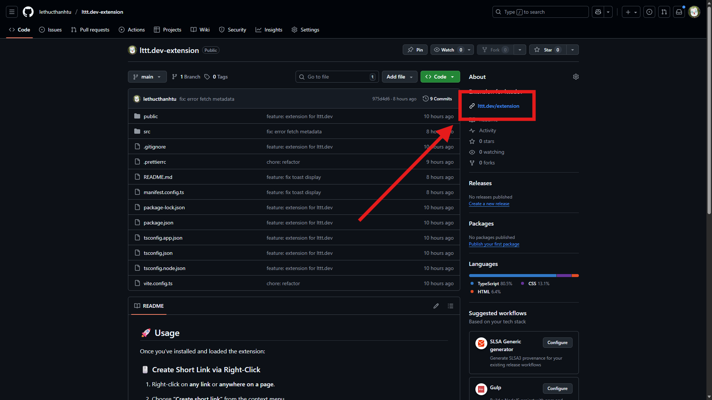

# lttt.dev Extension

A Chromium based extension for [**lttt.dev**](https://lttt.dev) — quickly create short links directly from your browser.

---

## 🚀 Features

- Right-click any link/page → **“Create short link”** using lttt.dev
- Quickly open [lttt.dev](https://lttt.dev) from the extension icon
- Works seamlessly with your logged-in lttt.dev account
- Optional **bridge**: lets a signed web app on `lttt.dev` or `*.lttt.dev` get data (cookies, pages) from another site with your session there, after you allow it (see below)

---

## 🧩 Installation

### Option 1: Install from ZIP file (recommended for manual install)

1. Download the latest build: [**lttt.dev-extension.zip**](https://github.com/lethucthanhtu/lttt.dev-extension/raw/main/release/lttt.dev-extension.zip)
   (it lives in [`release/`](./release) in this repo), or from the [**Download**](https://lttt.dev/extension) page.
   
2. Extract it into a folder you keep (the browser loads the extension from there; deleting the folder removes it).
3. Open Chrome/Edge and go to:

- Chrome

  ```txt
  chrome://extensions/
  ```

- Edge

  ```txt
  edge://extensions/
  ```

4. Enable **Developer Mode** (toggle in the top right corner).
5. Click **“Load unpacked”** → select the extracted folder.
6. The **lttt.dev** icon will appear in your browser toolbar.

To update, download the new zip, replace the folder's contents and click the reload icon on the extension's card. The
prebuilt zip is built with the project's `key`, so its extension ID is the same on every computer.

### Option 2: Install from Chrome Web Store

_Coming soon..._

---

### Option 3: Build it yourself

#### Prerequisites

- Git

- Node.js & npm

- A Chromium-based browser (Chrome, Edge, etc.)

#### Installation & Build

1. Clone the repository:

   ```bash
   git clone https://github.com/lethucthanhtu/lttt.dev-extension.git
   cd lttt.dev-extension
   ```

2. Install dependencies:

   ```bash
   npm install
   ```

3. Build the extension:

   ```bash
   npm run build
   ```

4. In the `release/` folder, unzip `.zip` file and load in Chrome/Edge via **Load unpacked** (same as above).

---

## 🔐 Bridge

Lets a web app on `lttt.dev` or `*.lttt.dev` get data from another site (the **source**) using your session there: read a cookie, read all of its cookies, or load a page or API as you. The data goes back to the web app page. The extension is not tied to any site: each request names its source, and you approve every (web app, source) pair once.

Example: `app.lttt.dev` asks for the `session` cookie of `https://accounts.example.com`, and `other.lttt.dev` asks for `https://example.com/api/me`. Each pair gets its own approval.

A page can talk to the extension only if:

- it is served from an `https` subdomain of `lttt.dev` (for example `https://app.lttt.dev`) on the default port, in the top frame of a tab, and
- it sends a **signed certificate** (cert v4) that lists its origin. The certificate is only a key: it says which apps may talk to the extension, not which sites they may read.

Every other page gets **no reply at all**, so it cannot detect the extension.

### How it works

1. On install and on browser start, the extension registers a small content script for `https://lttt.dev/*` and `https://*.lttt.dev/*` only. It forwards the page's messages to the background service worker, and replies to the page only if the background accepted it.
2. The background checks the sender from `sender.origin`, which the browser sets (the page cannot fake it). The message must come from this extension's content script, in the top frame of a tab, with a valid certificate listing that origin.
3. For a request, the background:
   - checks the request (source origin, items, URLs);
   - looks up your decision for this (app, source) pair. If there is none, it opens a small **consent window** ("Allow access?") and replies `pending` / `CONSENT_REQUIRED`. Allow is enabled after 1 second, so a stray click cannot approve;
   - if the request asks for a session and you are not logged in to the source, opens the source's login page in a tab and replies `pending` / `LOGIN_STARTED`;
   - otherwise reads the cookies or fetches the URLs and replies `result` with the data.
4. After you answer the consent window or log in, the result is sent to the tab that asked, with the same `id`.
5. Your decisions are kept in `chrome.storage.local`. Pending consents and logins (origins, URLs, tab ids, no data) are kept in `chrome.storage.session` for 10 minutes. Data is never stored or logged.

Manage decisions on the extension's **Options** page (extension details → **Extension options**): it lists every app → site decision, and **Revoke** removes it, so the app asks again next time.

### Permissions trade-off

The source may be any `https` site, so the extension requires host access to `https://*/*` (plus `https://lttt.dev/*` for short links). Chrome shows the install warning **"Read and change all your data on all websites"**.

What limits the risk:

- The content script runs only on `https://lttt.dev/*` and `https://*.lttt.dev/*`, and answers only pages the background accepted.
- Only apps listed in a certificate signed by the project's key can talk to the extension. The signing private key never enters this repo.
- Nothing is read from a site until you allow that app to use it, in a window the page cannot draw or click. Denials are remembered too, and you can revoke any decision.
- Data goes only to the page that asked (same origin, top frame).

You can also limit the extension's site access in the browser (extension details → **Site access** → "On specific sites"). A request for a source it cannot access returns `NO_PERMISSION`.

**Security:** an allowed app gets the source's cookies and pages as you. Allow only apps and sites you trust. Session cookies are credentials: a web app should send them only to its own server, over HTTPS, and never log them.

### Protocol (v5)

All messages use `window.postMessage(…, location.origin)` on the web app page. The page sends `source: 'lttt-bridge'`; the extension replies with `source: 'lttt-bridge-ext'`. `id` is a string or number chosen by the page.

| Page → extension | Extension → page |
| --- | --- |
| `{type:'ping', id, cert}` | `{type:'pong', id, version: 5, extVersion: '3.1.0'}` |
| `{type:'request', id, cert, request}` | `{type:'pending', id, code}` then `{type:'result', id, ok, data?, code?}` |
| | or `{type:'result', id, ok, data?, code?}` directly |

**Request.** All fields come from the page, so all are checked; one invalid field gives `BAD_REQUEST`.

```js
{
  source: 'https://accounts.example.com',          // an https origin exactly (no path)
  get: [                                            // 1 to 16 items, answered in order
    { type: 'cookie', name: 'session' },            // → { value: string | null }
    { type: 'cookies' },                            // → { cookies: { [name]: value } }
    { type: 'fetch', url: '/api/me',                // → { status, contentType, body }
      method: 'GET', headers: {}, body: undefined } //   method/headers/body optional
  ],
  session: { cookie: 'session', login: '/login', relogin: false } // optional
}
```

- `cookie` and `cookies` read the cookies the browser would send to `source` (including `HttpOnly` cookies).
- `fetch` loads a URL with your cookies for `source` (`credentials: 'include'`, no cache). The URL (a path or a full URL) must stay on `source`. Methods: `GET`, `HEAD`, `POST`, `PUT`, `PATCH`, `DELETE`; `body` is a string (not for `GET`/`HEAD`). Redirects are not followed. Timeout 15 s; the body is returned as text, up to 5 MB.
- A failed item gives `{error: 'FAILED'}` or `{error: 'TOO_LARGE'}` in its place; the other items still run.
- `session` (optional) makes sure you are logged in first. If the `cookie` is missing, or `relogin` is `true` (the app rejected the session it got), the extension opens `login` (a path on `source`, default `/login`) and replies `pending` / `LOGIN_STARTED`. When that cookie is set within 10 minutes, the request runs and the `result` follows.

**Result.** `{ok: true, data: [...]}` with one entry per item, or `{ok: false, code}`:

| Code | Meaning |
| --- | --- |
| `BAD_REQUEST` | The request is malformed (see above). |
| `DENIED` | You denied this app access to this source (revoke it on the Options page to be asked again). |
| `NO_PERMISSION` | Site access to the source is missing (for example, limited in the browser settings). |
| `CANCELLED` | You closed the consent window, or a newer login request (another app, source or login page) replaced this one. |
| `FAILED` | Unexpected error (for example, the extension was reloaded). |

Pending codes: `CONSENT_REQUIRED` (the consent window is open) and `LOGIN_STARTED` (the login tab is open). Asking again for the same pair while its consent window is open focuses that window. There is at most one pending login; a second one reuses its tab. If you do nothing for 10 minutes, no `result` is sent: the page should time out on its own.

**Breaking change in 3.0.0:** the message sources, the request format and the certificate (`v: 4`) changed. Pages and certificates for older versions get no reply. The extension no longer posts to the app's server: the page receives the data and decides what to do with it.

**Certificate.** `cert` is a string of at most 4 KB:

```text
cert    = base64url(payload JSON) + "." + base64url(signature)
payload = { "v": 4, "apps": ["https://lttt.dev", "https://app.lttt.dev", "https://*.lttt.dev"] }
```

- The signature is ECDSA P-256 with SHA-256, in IEEE-P1363 form (64 bytes, `r‖s`), over the ASCII bytes of the first part. base64url has no padding.
- `v` must be `4`. Older certificates are rejected.
- `apps` holds 1 to 32 entries. Each is either:
  - an exact origin `https://lttt.dev` (the apex, since 3.1.0) or `https://<sub>.lttt.dev` (default port, no credentials, any path ignored); or
  - a wildcard `https://*.lttt.dev` or `https://*.<sub>.lttt.dev`, matching every `https` origin on the default port whose host is a subdomain of that base, at any depth. No port or path. A wildcard never matches its own base: `https://*.lttt.dev` does not cover `https://lttt.dev`, which must be listed exactly.

  One invalid entry (another domain, `http`, a port, `localhost`…) invalidates the whole certificate.
  - **Security:** with a wildcard, any matching subdomain can talk to the extension (consent is still asked per app origin). Use one only if you control every subdomain: no user-generated content, no third-party previews, no dangling DNS records (subdomain takeover).
- The background verifies the certificate with WebCrypto against the public key built into the extension, and caches the result per certificate string in memory. A missing, oversized, malformed or badly signed certificate is treated as no certificate: the page gets no reply.
- Signing a certificate (outside this repo) with Node:

  ```js
  const body = Buffer.from(JSON.stringify({ v: 4, apps })).toString('base64url');
  const sig = crypto.sign('sha256', Buffer.from(body), { key: privatePem, dsaEncoding: 'ieee-p1363' });
  const cert = `${body}.${sig.toString('base64url')}`;
  ```

**Example (page side):**

```js
const id = crypto.randomUUID();
window.addEventListener('message', (e) => {
  if (e.source !== window || e.data?.source !== 'lttt-bridge-ext' || e.data.id !== id) return;
  if (e.data.type === 'pending') showWaiting(e.data.code);
  if (e.data.type === 'result') e.data.ok ? use(e.data.data) : showError(e.data.code);
});
window.postMessage({
  source: 'lttt-bridge', type: 'request', id, cert: APP_CERT,
  request: {
    source: 'https://accounts.example.com',
    get: [{ type: 'cookie', name: 'session' }],
    session: { cookie: 'session' },
  },
}, location.origin);
```

### Using your own signing key (forks)

The built-in public key only trusts certificates signed by this project's private key. A fork that serves its own apps should use its own key pair:

```bash
# 1. Generate a P-256 private key ONCE and keep it OUTSIDE the repo (never commit it)
openssl ecparam -name prime256v1 -genkey -noout | openssl pkcs8 -topk8 -nocrypt -out ~/keys/my-bridge-signing.pem

# 2. Public key (base64 SPKI DER) → build-time env var (read by vite.config.ts)
echo "EXTENSION_SIGNING_PUBLIC_KEY=$(openssl pkey -in ~/keys/my-bridge-signing.pem -pubout -outform DER | openssl base64 -A)" >> .env.local
```

3. Build (`npm run build`). The build then trusts only certificates signed by your key.
4. Sign a certificate for your web apps with your private key (see the Node snippet above), and give it to the web app to send in `ping`/`request`.

If `EXTENSION_SIGNING_PUBLIC_KEY` is empty or unset, the default key is used. The app domain (`lttt.dev`) is fixed in `src/bridge/config.ts` and `src/bridge/register.ts`; a fork changes both.

### Stable extension ID (`key`)

A web app's server may want to check which extension it talks to, and the Options page and consent window live at `chrome-extension://<id>`. Without a `key`, Chrome derives an unpacked extension's ID from the folder path, so the ID changes from machine to machine. To pin the ID:

```bash
# 1. Generate a private key ONCE and keep it OUTSIDE the repo (never commit it)
openssl genrsa -out ~/keys/my-extension-key.pem 2048

# 2. Public key (base64 DER) → build-time env var (read by manifest.config.ts)
echo "EXTENSION_PUBLIC_KEY=$(openssl rsa -in ~/keys/my-extension-key.pem -pubout -outform DER | openssl base64 -A)" > .env.local

# 3. The resulting extension ID
openssl rsa -in ~/keys/my-extension-key.pem -pubout -outform DER | openssl dgst -sha256 -r | head -c 32 | tr '0-9a-f' 'a-p'; echo
```

- `.env.local` is git-ignored. You can also pass `EXTENSION_PUBLIC_KEY` as an environment variable in CI.
- Without it, the build simply has no `key`.
- Check the ID in `chrome://extensions` (Developer mode) after loading the build.
- The Chrome Web Store assigns its own ID and key. You can use the store's public key as `EXTENSION_PUBLIC_KEY`, so that dev builds share the store ID.

### Manual test

Prerequisites:
- an account on a source site you can log in to (for example `https://accounts.example.com`);
- a web app deployed on `lttt.dev` or a `*.lttt.dev` subdomain with a valid certificate for its origin.

1. Run `npm run build`, then load `dist/` unpacked. Confirm the ID in `chrome://extensions`.
2. Detection: open the web app. It should detect the extension (`pong` with `version: 5`). On any other site, in the DevTools console, `window.postMessage({source:'lttt-bridge',type:'ping',id:1,cert:'x'}, location.origin)` should get no reply. The app's certificate sent from a `lttt.dev` / `*.lttt.dev` page it does not list should get no reply either.
3. Consent: send a request for the source. Expect `pending` / `CONSENT_REQUIRED` and the consent window showing the app and the source.
   - Close the window → `result` / `CANCELLED`.
   - Ask again and click **Deny** → `DENIED`; asking again returns `DENIED` at once.
   - Revoke it on the Options page, ask again and click **Allow** → `result` with the data.
4. Login: log out of the source and send a request with `session`. Expect `pending` / `LOGIN_STARTED` and the login page in a new tab. Log in (in that tab or any other): the `result` should arrive with the data. Closing the login tab does not cancel; the wait ends after 10 minutes.
5. `fetch`: a URL on another origin → `BAD_REQUEST`; a URL that redirects → `{error: 'FAILED'}` for that item.
6. Set the extension's **Site access** to "On specific sites" without the source → `NO_PERMISSION`.
7. Repeat in Edge / Brave / Opera if you use them.

Note: `npm run dev` (the crxjs dev server) makes all extension files web-accessible for HMR, so dev builds *are* detectable by any site. Test detection only with `npm run build`.

---

## 🧱 Tech Stack

- [Vite](https://vitejs.dev/)
- [TypeScript](https://www.typescriptlang.org/)
- [React](https://react.dev/) + [Tailwind CSS](https://tailwindcss.com/) — consent and options pages (the content script stays plain TypeScript)
- [CRXJS](https://crxjs.dev/vite-plugin) — Chrome Extension tooling
